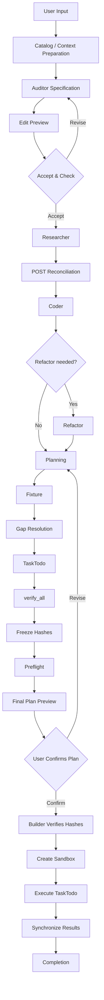

# Breakdown — Skill-based OneShot Runtime

Migration source: [OneShot-Continuing](https://github.com/itz1508/OneShot-Continuing) at `dbecd79e58b5b43592009d3cc914fcdc2722413b`. Destination baseline: `d53c0e8ace51bd811bc7af39e78a280a52391a21`.

## Product workflow (reference for the product specification)



### Two confirmation gates

| Gate | Purpose | Authorizes |
| --- | --- | --- |
| Accept & Check | Review Auditor specification through Edit Preview | Researcher execution |
| User Confirms Plan | Review final plan and frozen execution materials | Builder execution |

### Ownership distinctions

| Component | Responsibility |
| --- | --- |
| Catalog | Context and reusable knowledge preparation |
| Auditor | Specification and PRE/POST reconciliation |
| Researcher | Evidence collection |
| Coder | Code analysis and refactoring when necessary |
| Planner | Planning, fixtures, gap resolution and TaskTodo preparation |
| `verify_all` | Required pre-build verification |
| Builder | Verify hashes, create sandbox and execute TaskTodo |
| Storage | Synchronize and retain actual results |

### Critical execution rules

1. No Researcher execution before Accept & Check.
2. Coder does not automatically refactor; refactoring is conditional.
3. Planning must resolve gaps and prepare TaskTodo before `verify_all`.
4. Hashes are frozen before Preflight and final plan confirmation.
5. Builder independently checks the confirmed hashes before creating the sandbox.
6. Sandbox execution must use the confirmed TaskTodo and scope.
7. Synchronize actual execution results before Completion.

Post-completion validation is optional, not a mandatory workflow stage. `verify_all` remains in its specified pre-build position. Build and Rebuild use this exact same workflow; only their implementation baseline differs.

## Role packages (contract / entry / runtime implementation)

| Role | Contract | Entry | Runtime implementation |
| --- | --- | --- | --- |
| Auditor | `audit.yaml` | `audit.py` | `auditing.py` |
| Researcher | `research.yaml` | `research.py` | `researching.py` |
| Planner | `plan.yaml` | `plan.py` | `planning.py` |
| Builder | `build.yaml` | `build.py` | `building.py` |
| Coder | `code.yaml` | `code.py` | `coding.py` |

Builder owns its execution implementation (`effect_executor.py`). There is no duplicated generic `contracts/` or `host/` ownership: the singular `agent/host/` package owns the generic runtime, storage, providers, and cross-role contracts; cross-stage validation modules live with Planner's gap resolution (`agent/skills/planner/contracts/validation/`).

`agent.host.skill_dispatch` checks the persisted Host dispatch envelope before importing a role. Existing role ID `audit_discovery` is intentionally retained even though the package is named `auditor`.

## Trust and execution

The host (`agent/host/`) retains the controller, authorization, artifacts, receipts, event logs, Scanner gateway and evidence, specification freeze, package lock, build admission, effect execution and recovery. Skills do not mint trusted receipts or change stage transitions.

**CodeDesign:** Audit Discovery owns source-grounded candidate preparation and evidence questions; Planning owns subsequent design decisions and `CodeDesignReview`. The legacy `CodeIntent` wire field and persisted artifacts remain readable for compatibility until an independently validated storage and Vector Search migration occurs.

## Local verification

```sh
uv sync --locked --extra meta
uv run --no-sync python -m agent skills
uv run --no-sync python -m agent doctor
uv lock --check
uv run --no-sync ruff check .
uv run --no-sync mypy agent
uv run --no-sync pytest -q
```

The CLI and Scanner execution do not by themselves establish full connected workflow E2E completion. Independent Build Validation and recovery verification require executed evidence.

## Package status

The `package-integrity` CI job builds a wheel and a pinned source ZIP containing `uv.lock`, verifies the bundled Catalog and Meta provider configuration, enforces retired-path exclusions, and runs focused tests on Python 3.11 and 3.12.

Retired `mvp/`, `.agents/`, `.tools/`, `.venv*`, and `agent/skills/shared/` paths are not packaged or reconstructed. The production Researcher fails closed until a Host-provisioned executor is configured. Legacy MVP-specific tests, the full repository CI suite, exact frozen-action binding, and independent connected E2E verification remain **release blockers**; consult the individual CI jobs rather than treating wheel availability as certification.
